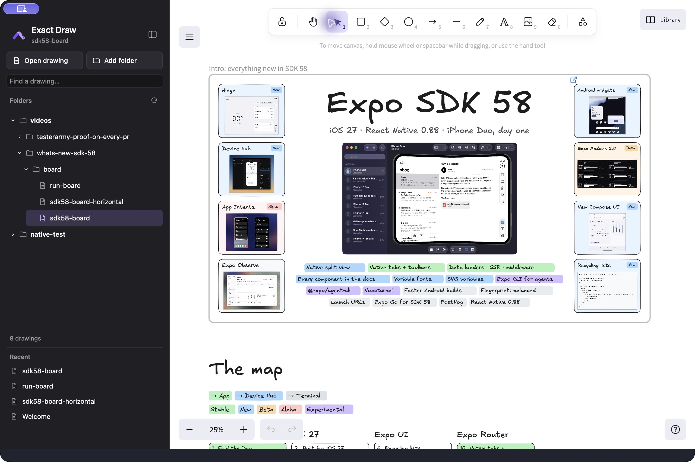
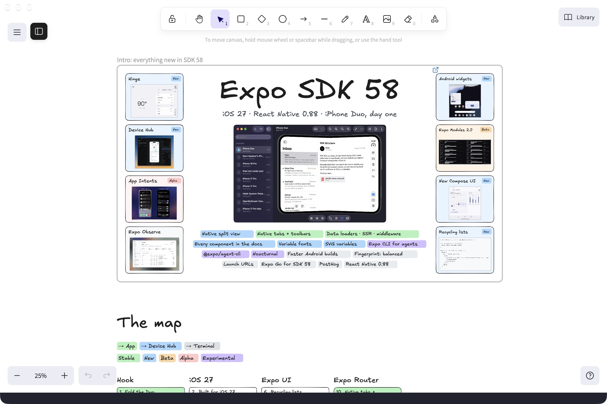

# Exact Draw

A focused macOS home for your Excalidraw files. Open drawings from your own folders, edit them with the official Excalidraw canvas, and see changes made by other tools without reopening the file.

## Why it exists

A drawing often lives alongside the work it explains: source code, notes, a video script, or a project folder. Exact Draw keeps that relationship intact. Your drawings stay as ordinary `.excalidraw` files wherever you keep them, with a desktop explorer for finding and reopening them.

It is built for a workflow where you and an external tool, including an AI coding agent, take turns editing a drawing. When the file changes on disk, the editor refreshes while preserving your view. When you draw, your changes autosave to the same file. Version checks and recovery copies help protect against saving over an external change you have not loaded.

The project also explores what it takes to build a practical desktop app with [Exact](https://github.com/ccheever/exact2). Exact provides the native shell and file explorer; the official Excalidraw editor runs in an embedded WebKit view. Framework gaps, integration decisions, and verification evidence are recorded in the [Exact experience journal](docs/exact-experience.md).

## What you can do

- **Work with your own files.** Choose a drawing or add a folder through the macOS file picker. Multiple folders stay in your workspace across restarts.
- **Browse only drawings.** The explorer shows `.excalidraw` files and their folder hierarchy. Discovery runs in the background, skips dependency/build directories and symlinks, and does not read unrelated file contents.
- **Find and return to work.** Search drawing paths, expand folders, and reopen files from Recents. Drawing labels omit the extension to keep the list readable.
- **See external edits.** The active drawing updates when another tool changes its file. Folder discovery leaves the current canvas open.
- **Keep the canvas in focus.** Hide the sidebar completely and bring it back with the floating sidebar icon.
- **Organize without moving files.** Right-click a workspace folder and choose **Remove from workspace**. Its files stay on disk, and an open drawing stays open.

The intended editing model is taking turns, rather than simultaneous collaboration. If a save detects a newer disk version, it refuses the stale write and preserves conflicting local edits for recovery.

## Screenshots

Installed macOS app, captured October 16, 2026, with the canvas extending to the top of the window.

| Sidebar open | Sidebar hidden |
| --- | --- |
|  |  |
| Folder explorer, recent drawings, and the full-height canvas. | Full-width, full-height canvas with a floating sidebar toggle. |

## Current status

Exact Draw is an early local macOS app. A packaged build launches directly from Applications and starts its bundled file service automatically. See [Developing Exact Draw](DEVELOPMENT.md) for building and installing it.

It supports ordinary `.excalidraw` files. Obsidian's `.excalidraw.md` format, Obsidian plugins, live collaboration, and hosted sharing are outside the current implementation. iCloud placeholder handling and coordinated cloud writes have not been qualified, and very large image-heavy drawings need further profiling.

## Build and contribute

See [DEVELOPMENT.md](DEVELOPMENT.md) for prerequisites, first-run setup, the project structure, tests, and technical limitations.
